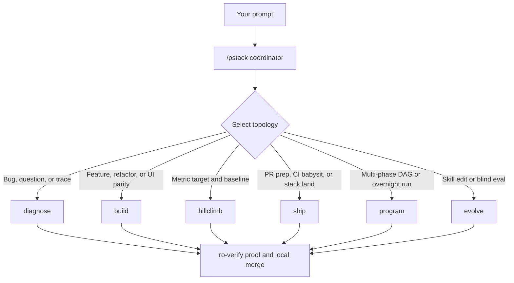

# Route work through `/pstack`

[`/pstack`](../../skills/pstack/SKILL.md) is the swarm coordinator kernel. You describe the outcome and how to verify it. The coordinator selects one of six composable topologies, sizes a prefix-typed worker roster on the native swarm board, enforces worktree boundaries through `hooks/guard.mjs`, and lands only verified commits.


## How `/pstack` routes your prompt



Each topology lives under `skills/pstack/topologies/` and composes cleanly when a task spans stages, such as diagnosing a race (`diagnose`), building the fix (`build`), and babysitting the PR (`ship`). When an obstacle blocks progress, `/pstack` builds the missing local lever or harness autonomously instead of stopping on preventable friction.

## State the outcome, not the ceremony

Skip hand-written implementation plans. State what is broken or what behavior you want, plus any known context that saves search time:

```text
/agy-pstack-next:pstack users receive duplicate webhook deliveries after a worker restart. reproduce first, fix the root cause, and prove retries stay idempotent.
```

`"reproduce first"` is an executable constraint. In [`diagnose`](../../skills/pstack/topologies/diagnose.md), parallel `ro-*` workers trace competing hypotheses first, then the coordinator forks the winning investigator (`fork: "ro-winner"`) into an `impl-fix` (`workspace: "share"`) worktree to write the failing repro test and fix before `ro-verify` confirms it.

## Five ingredients of a high-signal prompt

Most great `/pstack` prompts fit in two to four sentences built from five pieces.

- **The goal.** Name the broken behavior or the target capability.
- **The finish check.** Give a predicate that passes or fails, never `"make it cleaner"` or `"work for two hours"`.
- **The proof artifact.** Ask for command output, before-and-after timings, an ARIA snapshot, screenshots, or a counterexample trace.
- **Known clues.** Include a failing job ID, stack frame, commit SHA, or fixture path you already have.
- **Hard constraints.** Phrases like `"reproduce first"`, `"do not edit code yet"`, `"zero behavior change"`, or `"pause before opening a PR"` set explicit boundaries.

Here is all five in one prompt:

```text
/agy-pstack-next:pstack CSV exports drop the final row on batches over 50k records (see job 4812). reproduce first, then fix. done means the 60k-row fixture exports all 60,000 rows. show before-and-after row counts.
```

Leave two things out of your opening prompt.

- **Do not script the internal skill chain.** Writing `"run /understand then /crucible then /interrogate"` overrides topology gates that already sequence those steps when needed.
- **Hold back unverified guesses at first.** Leading with a hunch narrows exploration. For messy issue threads, ask `/pstack` to restate the underlying problem in plain words without changing code first, and correct any misread before implementation begins.

If you want help tightening a high-stakes prompt before launching a swarm, ask [`/setup-pstack`](../../skills/setup-pstack/SKILL.md) to sharpen the prompt and recommend the best topology.

## Mechanical worktree isolation and board hygiene

Running parallel authors in one directory corrupts files, git index state, and dev ports. Pstack v2 isolates swarm execution mechanically.

- **`workspace: "share"` per author.** Every `impl-*`, `cand-*`, `lead-*`, `adv-*`, and `sicko-*` worker gets its own git working copy. [`hooks/guard.mjs`](../../hooks/guard.mjs) resolves `realpathSync` on every `edit_file` and `write_file` call so no worker can escape its worktree via `../` or symlinks.
- **Read-only `ro-*` workers.** Explorers and verifiers run in `workspace: "inherit"` with zero repository write permissions, keeping temporary test artifacts strictly under `/tmp`.
- **Merge before `kill`.** Calling `swarm{action: "kill"}` permanently deletes a worker's `share` worktree. The coordinator always fetches and merges (or cherry-picks) verified worker SHAs before killing any worker.
- **`#seq` citations and doorbell `@mentions`.** Workers reference earlier board messages by `#seq` number rather than pasting duplicate logs, and `@mention` only the specific peer who needs to wake next.

When stale worktrees accumulate across cancelled sessions, run `/pstack` (`program` topology) to audit merge status and uncommitted diffs before pruning safe worktrees.

## Follow-ups, task switches, and stepping away

Inside an active thread, short follow-ups work cleanly because the swarm board retains `#seq` history:

```text
/agy-pstack-next:pstack proceed with option B and verify it
```

When switching to an unrelated problem in the same chat, say `"new task"` explicitly so the coordinator selects a fresh topology instead of extending the previous one:

```text
/agy-pstack-next:pstack new task. trace why session tokens survive logout. do not change code yet.
```

When stepping away from your keyboard, pair `/pstack` with Antigravity's `/goal` command and state your finish predicate clearly. [Run work while you sleep](./07-overnight.md) covers the full autonomous contract.

Continue to [Understand the code](./03-understand.md).
