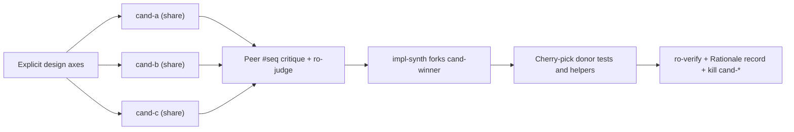

# Design before you write code

Accepting the first design an agent proposes locks in the first shape it thought of. Polishing an abstract prose spec that never touched a compiler fails the opposite way. Pstack v2 pairs [`/crucible`](../../skills/crucible/SKILL.md) for parallel multi-axis exploration, [`/statechart`](../../skills/statechart/SKILL.md) for checked state transitions, and [`/interrogate`](../../skills/interrogate/SKILL.md) for adversarial stress-testing and blast-radius analysis.


## Explore orthogonal designs in `/crucible`

[`/crucible`](../../skills/crucible/SKILL.md) assigns explicit, orthogonal design axes to parallel candidates (`cand-a`, `cand-b`, `cand-c`) on the swarm board instead of running redundant clones of one vague prompt. Pick between two fidelity modes based on uncertainty and cost.

### `sketch` mode for boundaries and types

Use `sketch` when settling public APIs, module boundaries, or data schemas before writing full implementations:

```text
/crucible sketch three competing designs for the streaming import pipeline. prioritize caller ergonomics and backpressure safety.
```

Each `cand-*` produces caller usage code first, followed by concrete types, state transitions, failure matrices, and diff sketches. Peers critique each other's sketches by `#seq` citation on the board, and a cross-family `ro-judge` evaluates candidates against [`design-red-flags.md`](../../skills/crucible/references/design-red-flags.md) (plus an optional `ro-steward` boundary audit).

### `full` mode for working prototypes

Use `full` when only running code, tests, or benchmarks can settle an empirical trade-off:

```text
/crucible full compare three cache eviction layouts in isolated worktrees and benchmark p99 lookup latency on the replay fixture.
```

Each `cand-*` builds a working prototype with passing tests in its own `workspace: "share"` worktree.



### Synthesis without losing donor work

When a winner emerges, `/crucible` leaves `cand-*` workers parked in `waiting` (which costs zero tokens while keeping their `share` worktrees alive). `impl-synth` spawns with `workspace: "share"` and `fork: "cand-winner"`, cherry-picks the strongest tests or helpers from donor `cand-*` branches, records the rationale per [`rationale-template.md`](../../skills/crucible/references/rationale-template.md), passes `ro-verify`, and lands locally. Only after landing does the coordinator call `swarm{action: "kill"}` on `cand-*`.

## Model tricky state machines with `/statechart`

Prose hides race conditions and deadlocks. Whenever a feature crosses async states, retries, leases, or offline sync, check the state graph first with [`/statechart`](../../skills/statechart/SKILL.md):

```text
/statechart model the offline draft sync flow and check that an unsaved local edit is never overwritten by a stale server poll.
```

`/statechart` runs TLC over a TLA+ spec in an isolated `/tmp` directory and renders a Mermaid (or Pele SVG) chart using domain labels. States that violate invariants carry `breaks` marks along with the shortest path to trigger them.

## Write the caller's README first

For shared libraries, CLIs, or internal packages, ask `/pstack` to draft the caller-facing how-to or tutorial first under [`/technical-writing`](../../skills/technical-writing/SKILL.md) rules before implementing internals:

```text
/pstack write the usage guide for the v2 config loader first with /technical-writing, pause for my review, then build the implementation to match it.
```

Writing caller usage first exposes awkward flags and leaky types while changing them still costs ten lines of markdown.

## Break diffs and map blast radius with `/interrogate`

Once real code or a prototype exists, turn adversaries loose on it with [`/interrogate`](../../skills/interrogate/SKILL.md):

```text
/interrogate stress-test this branch and map every downstream caller and migration hazard. report only reproducible bugs.
```

`/interrogate` combines two complementary checks on the swarm board.

- **Adversarial bug hunters (`adv-*`, `workspace: "share"`).** Write executable exploit probes and failing tests in isolated worktrees (`git push` mechanically disabled), deduplicating bug claims live via `#seq` posts and chaining cross-boundary findings.
- **Blast-radius mapper (`ro-blast`, `workspace: "inherit"`).** Traces transitive callers, serialization contracts, schema migrations, and rollout ordering hazards.

`ro-verify` reruns every candidate finding and drops unverified speculation, so your report contains only reproducible failures or exact `file:line` state traces.

## Sequence multi-PR plans after design settles

Pstack skips standalone abstract planning skills because untested plans rot on contact with code. Once `/crucible` or a prototype settles open questions, ask `/pstack` (`program` topology) to slice delivery into small, independently verifiable commits or stacked PRs:

```text
/pstack slice the approved store design into a stacked PR plan where every step compiles, passes verification, and migrates one bounded caller group.
```

## Match design rigor to blast radius

Most changes do not need every tool on this page. Scale scrutiny to the cost of reversing a mistake.

- **Small localized diff.** Run `/interrogate` before shipping.
- **New module boundary or public interface.** Run `/crucible` (`sketch` mode).
- **Empirical performance or UX trade-off.** Run `/crucible` (`full` mode) with `/control-ui` or benchmark evidence.
- **Stateful protocol, lock, or retry loop.** Model it with `/statechart`, implement via `/pstack`, then audit with `/interrogate`.
- **Multi-week migration.** Settle the boundary in `/crucible`, then sequence phases in `/pstack` (`program` topology).

Continue to [Build and clean the change](./05-build-and-clean.md).
