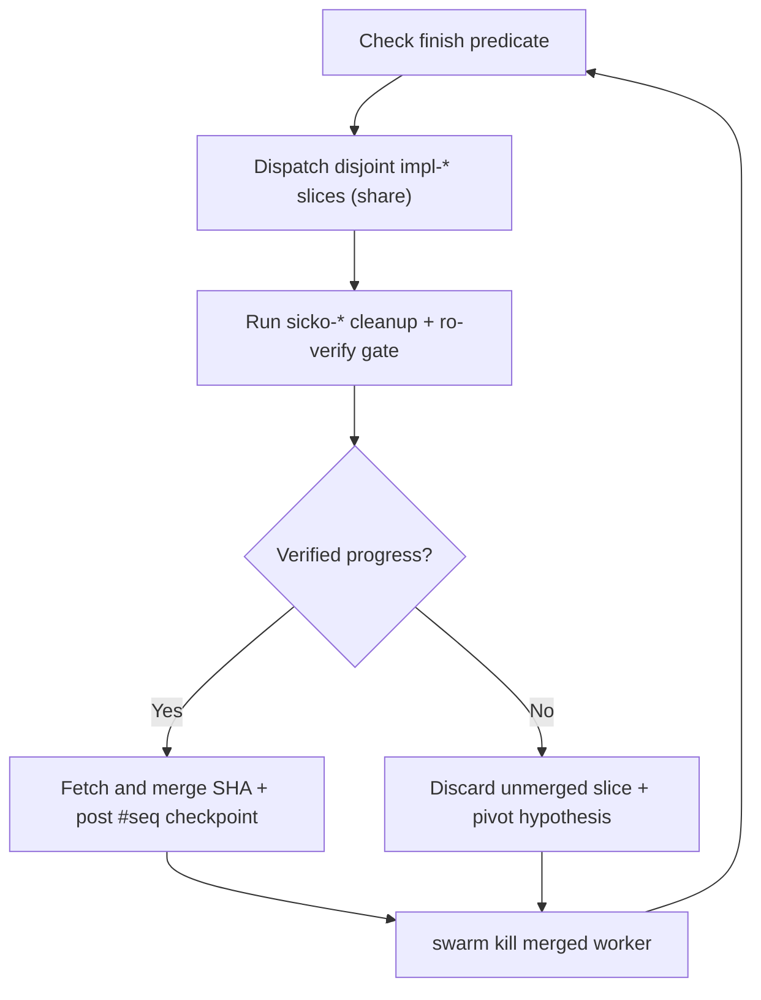

# Run work while you sleep

Autonomous overnight runs pay off only after verification is rock-solid. What makes an unattended `/pstack` swarm trustworthy is not optimism. It is a falsifiable finish condition, hook-confined `workspace: "share"` worktrees, `#seq` board checkpoints, and independent `ro-verify` gates on every slice.


## Earn trust before leaving a loop unattended

An unverified loop only manufactures broken diffs faster. Confirm four prerequisites while watching interactively before handing `/pstack` an overnight run.

- You have watched `/pstack` complete a slice of the same shape interactively and seen what good proof looks like.
- The repository has executable verification levers (`verify-<app>` from `/verify-gen`, deterministic integration suites, or benchmark harnesses).
- Every stage has an independent `ro-verify` gate capable of rejecting regressions instead of rubber-stamping compiles.
- Recurring repo footguns have already been encoded into types, lints, hooks, or role rules with [`/reflect`](../../skills/reflect/SKILL.md).

## The overnight contract

A crisp autonomous handoff states the goal, the pass/fail finish predicate, branch isolation, push or merge boundaries, and a clean stop condition when genuinely blocked:

```text
/pstack i am going to bed. migrate every caller from the legacy sync store to the async store on a fresh branch.
done means zero legacy imports remain, the full integration and verify-app suites pass, and the legacy module is deleted.
commit verified slices locally and do not push.
/goal keep going until done, or stop and post exact blockers if an external constraint prevents completion.
```

Each line carries operational weight in the [`program`](../../skills/pstack/topologies/program.md) topology.

- **Explicit autonomy signal.** Telling `/pstack` you are stepping away activates non-blocking execution (`Never Block on the Human`), reserving pauses strictly for irreversible or out-of-policy actions.
- **Executable finish predicate.** Every phase checks concrete commands (`zero legacy imports`, passing test and `/verify-gen` harnesses) rather than subjective quality claims.
- **Local commits, gated pushes.** Verified worker commits merge into your local target branch safely while `hooks/guard.mjs` prevents unrequested `git push` calls unless you explicitly ask to open or update remote PRs.
- **Built-in wake persistence.** Antigravity's `/goal` command and `schedule` timers keep the coordinator progressing across phases without busy-polling.

## How `program` checkpoints and resumes on the board



Every completed phase records its merged commit SHA, verified invariant, and remaining slice list directly on the native swarm board (`board.jsonl`) with `#seq` citations. Failed experiments never pollute the target branch, and finished `share` worktrees are killed immediately after `git merge` so disk usage stays flat all night.

If you need to pause a run before going offline or restarting Antigravity, tell the coordinator to pause safely. `program` lands or cleanly stashes active worktrees and posts a structured `#seq` resume checkpoint. A later turn or successor coordinator reconstructs exact program state via `read_board{since: 0}` and `git log` without redoing verified slices.

## Morning catch-up with `/ketchup`

When you return in the morning, run [`/ketchup`](../../skills/ketchup/SKILL.md) first:

```text
/ketchup
```

`/ketchup` inspects `view.json`, `board.jsonl` `#seq` checkpoints, `git log`, and any open PRs in parallel across `ro-*` workers. It summarizes what landed, shows captured screenshots or metrics, and lists any decisions or blockers waiting on your call with `#seq` evidence pointers. Add `--plain` for a quick zero-jargon read on your phone, or `--video` for a short subtitled slide recap.

## Scale across multi-area programs

When a migration or release spans more than eight workers or multiple independent subsystems, `program` scales hierarchically on the native swarm runtime.

- **Topic channels.** `swarm{action: "channel"}` partitions high-traffic subsystems (`#storage`, `#api`, `#ui`) so workers only wake on messages relevant to their area.
- **Area leads (`lead-<area>`).** Each subsystem lead owns a stacked branch in `workspace: "share"`, coordinates its slice authors and `ro-verify` checks, and hands verified phase heads up to the root coordinator.
- **Stacked PR queues (`program` + `ship`).** Ask `/pstack` to build a verified stack without merging (`"prepare stacked PRs and get CI green, i will merge in the morning"`) or, when explicitly authorized, land contiguous verified PRs bottom-up.

## Standing `/schedule` automations

Not every loop needs a manual kickoff. Use [`/setup-pstack`](../../skills/setup-pstack/SKILL.md) (or Antigravity's `/schedule` command) to configure recurring maintenance sweeps such as nightly `/verify-gen --maintain` drift checks, flaky-test quarantine probes, or morning `/ketchup` digests. Keep two rules on every scheduled workflow. Let every stage stop the line cleanly when nothing needs action, and attach concrete `#seq` and artifact proof whenever it proposes a change.

**Pitfall.** Never give `/goal` or `/schedule` a wall-clock duration (`"work on this for four hours"`) in place of a falsifiable predicate. Time limits reward churn, whereas pass/fail checks reward finishing cleanly.

Continue to [Steer with principle names](./08-principles.md).
